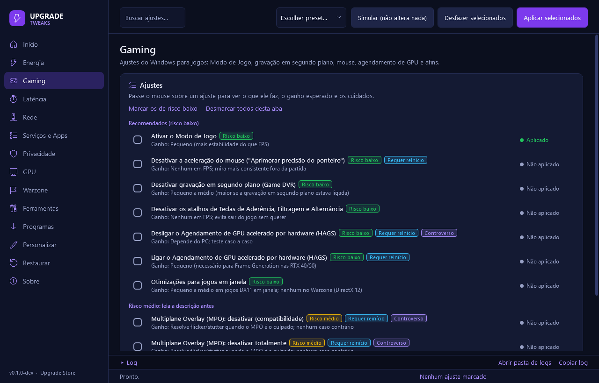
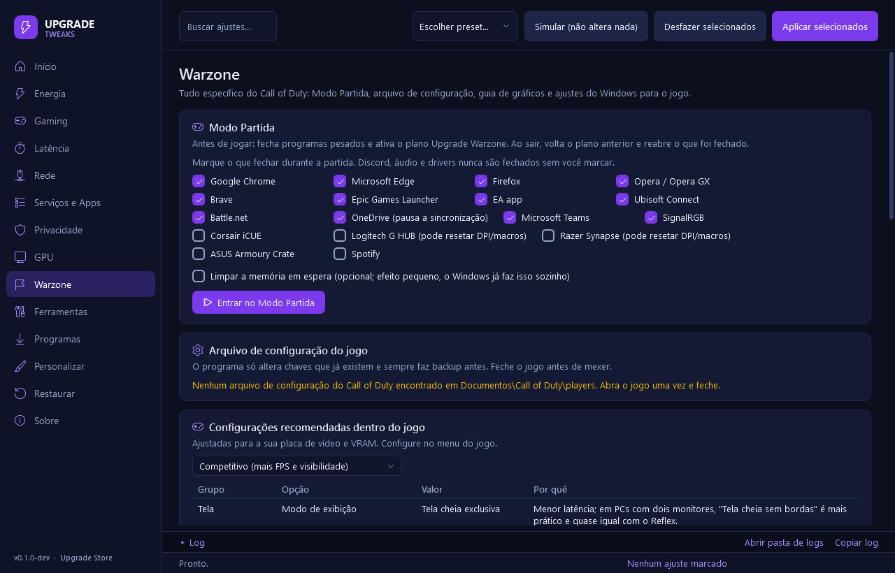

<p align="center"></p>

<p align="center">
  <a href="https://github.com/Buzzacar0/upgrade-tweaks/releases/latest"></a>
  <a href="LICENSE"></a>
  <a href="https://github.com/Buzzacar0/upgrade-tweaks/releases"></a>
  <a href="https://github.com/Buzzacar0/upgrade-tweaks/actions/workflows/ci.yml"></a>
</p>

Otimizador de Windows da **Upgrade Store** (Porto Alegre/RS), focado em desempenho, latência e estabilidade no **Call of Duty: Warzone**. Todo em português do Brasil, com descrição honesta de cada ajuste, ganho esperado, nível de risco e **desfazer para tudo**.

## Como usar

1. Clique com o botão direito no menu Iniciar e abra o **Terminal (Administrador)** ou o **Windows PowerShell (Administrador)**.
2. Cole o comando e aperte Enter:

```powershell
irm https://github.com/Buzzacar0/upgrade-tweaks/releases/latest/download/upgradetweaks.ps1 | iex
```

3. A janela do Upgrade Tweaks abre na tela **Início** com o diagnóstico do seu PC. Para começar sem pensar muito, clique em **Otimizar agora com o preset Seguro**.

> **Precisa ser administrador.** O programa mexe em registro do sistema, serviços, plano de energia e configurações do driver. Se for aberto sem privilégio, ele mesmo pede a permissão do Windows (UAC); se a permissão for negada, avisa e fecha sem alterar nada.

<p align="center">
  
  
</p>

## O que o programa faz, aba por aba

| Aba | O que tem |
|---|---|
| **Início** | Diagnóstico do hardware com **Nota de Otimização (0–100)**, pendências ordenadas por impacto (com a aba que resolve), relatório em HTML/TXT e os presets. |
| **Energia** | Plano **"Upgrade Warzone"** (processador a 100%, sem estacionamento de núcleos, sem economia em USB/PCIe/disco). Ryzen X3D de dois CCDs mantém o Equilibrado de propósito; notebook ganha um plano só para quando está na tomada. Exportar/importar `.pow`. |
| **Gaming** | Game DVR, Modo de Jogo, aceleração do mouse, HAGS, MMCSS, otimizações para jogos em janela, MPO. |
| **Latência** | Ajustes avançados e opcionais: modo MSI da placa de vídeo e de rede, tick dinâmico, Power Throttling, compressão de memória, mitigações de CPU. Cada um diz com franqueza o quanto ajuda (muitas vezes, pouco). |
| **Rede** | Teste de latência, jitter e perda (roteador e internet), comparação de DNS, QoS para o Call of Duty, economia de energia da placa de rede, Nagle, IPv4 preferido, limpar DNS e resetar a rede. |
| **Serviços e Apps** | Serviços em Manual, remoção de apps que não são de jogo, **Modo Lite** (debloat agressivo mostrado em lista antes) e gerenciador de inicialização. |
| **Privacidade** | Telemetria, ID de anúncios, histórico de atividades, Copilot, Recall, widgets, pesquisa do Bing e afins. |
| **GPU** | NVIDIA: perfil do Call of Duty e global gravados direto no driver (atual × recomendado, com backup), faixa de cor Completa, taxa máxima do monitor, power limit. Cache de shaders, drivers oficiais, guias de AMD/Intel/DDU e "só o driver de vídeo" da NVIDIA. |
| **Warzone** | **Modo Partida** (fecha o que pesa e ativa o plano Upgrade Warzone; ao sair, volta tudo), arquivo de configuração do jogo com backup, guia de gráficos para a sua placa e VRAM, exclusão no Defender. |
| **Ferramentas** | Limpeza de temporários, Limpeza de Disco, `sfc`/`DISM`, TRIM (nunca desfragmenta SSD), arquivo de paginação, pausar o Windows Update por até 35 dias, atalhos do sistema e **guia de BIOS** personalizado para o seu processador e placa-mãe. |
| **Programas** | MSI Afterburner, RTSS, HWiNFO64, OCCT, CPU-Z, GPU-Z, NVIDIA Profile Inspector, DDU, NVCleanstall, Autoruns, Process Lasso, O&O ShutUp10, 7-Zip, Everything, CrystalDiskInfo/Mark e outros: instalar, abrir (como administrador), atualizar e desinstalar pelo winget ou pela versão oficial no GitHub. |
| **Personalizar** | Tema escuro, barra de tarefas, extensões de arquivo, menu de contexto clássico, efeitos visuais. |
| **Restaurar** | **Desfazer TUDO**, backups por sessão, backups do driver NVIDIA, Restauração do Sistema. |
| **Sobre** | Versão, verificação de versão nova, aviso legal e créditos. |

Cada ajuste mostra o **risco** (baixo, médio, alto), se **requer reinício**, se é **controverso** e se já está **aplicado**. Ajustes de risco alto pedem confirmação um por um. O botão **Simular** mostra exatamente o que seria alterado (valor atual → valor novo) sem mexer em nada.

## Presets

| Preset | O que marca |
|---|---|
| **Seguro** (recomendado) | Só ajustes de risco baixo com ganho comprovado: Game DVR, Modo de Jogo, mouse, perfil NVIDIA do jogo, GPU dedicada, paginação e telemetria básica. |
| **Competitivo** | Seguro + risco médio sem efeitos colaterais conhecidos: plano Upgrade Warzone, MMCSS, rede, modo MSI, serviços em Manual, exclusão do Defender e debloat moderado. |
| **Extremo** | Competitivo + todo o resto de desempenho, inclusive risco alto. Pede para digitar **EU ENTENDO**. |

O que não se aplica ao hardware (X3D de dois CCDs, notebook, Xbox/Game Pass, fabricante da placa) é pulado sozinho. Personalização, escolha de DNS, serviços do Xbox e o Spooler de impressão nunca entram em preset. A lista exata de cada um está em [`config/presets.json`](config/presets.json).

Na tela Início dá para **exportar a seleção** marcada em JSON e **importar** em outro PC (ou usar com `-Config`).

## Linha de comando (sem interface)

Com o arquivo baixado:

```powershell
.\upgradetweaks.ps1 -Preset Seguro -Silencioso
.\upgradetweaks.ps1 -Config .\minha-config.json
.\upgradetweaks.ps1 -DesfazerTudo
.\upgradetweaks.ps1 -Diagnostico -ExportarRelatorio C:\relatorio.html
.\upgradetweaks.ps1 -Simular -Preset Competitivo
```

Direto da internet (o `irm | iex` não aceita parâmetros, então o script vira um bloco):

```powershell
& ([scriptblock]::Create((irm https://github.com/Buzzacar0/upgrade-tweaks/releases/latest/download/upgradetweaks.ps1))) -Preset Seguro
```

| Parâmetro | Efeito |
|---|---|
| `-Preset Seguro\|Competitivo\|Extremo` | Aplica o preset. Os ajustes de risco alto pedem para digitar `EU ENTENDO`; com `-Silencioso` eles são pulados. |
| `-Config arquivo.json` | Aplica uma seleção exportada pela interface. |
| `-DesfazerTudo` | Desfaz tudo que o programa aplicou, do último para o primeiro (pede `S` para confirmar, exceto com `-Silencioso`). |
| `-Diagnostico` / `-ExportarRelatorio caminho` | Mostra a nota e as pendências; o relatório pode ser `.html` ou `.txt`. |
| `-Simular` | Mostra tudo que seria feito sem alterar nada (sozinho, abre a interface em modo simulação). |
| `-Silencioso` | Sem saída no console e sem perguntas; tudo fica no log. |

A taxa de atualização do monitor nunca é alterada pela linha de comando: na interface ela tem 15 segundos para ser confirmada e volta sozinha se a tela apagar.

Código de saída: `0` ok, `1` algum ajuste falhou, `2` parâmetros inválidos, `3010` ok mas precisa reiniciar.

## Todos os ajustes

<!-- TABELA-AJUSTES:INICIO -->
Total: **152 ajustes**, todos com desfazer e detecção do estado atual. A coluna Preset mostra o primeiro preset que inclui o ajuste (Seguro está dentro do Competitivo, que está dentro do Extremo).

<details><summary><b>Energia</b> (5 ajustes)</summary>

| Ajuste | Risco | Ganho esperado | Reinício | Preset |
|---|---|---|---|---|
| Desativar a hibernação | baixo | Nenhum em FPS; libera espaço em disco | não | Competitivo |
| Manter o plano Equilibrado (Ryzen X3D de dois CCDs) | baixo | Médio a alto (o jogo roda no CCD com V-Cache) | não | Seguro |
| Mostrar configurações ocultas nas Opções de Energia | baixo | Nenhum por si só (permite ajuste manual) | não | — |
| Plano de energia Upgrade Warzone | médio | Pequeno a médio (frametime mais estável; maior em PCs que estavam no Equilibrado ou Economia) | não | Competitivo |
| Desativar o estado ocioso do processador (IDLEDISABLE) *(controverso)* | alto | Muito pequeno, quase sempre imperceptível no Warzone | não | Extremo |

</details>

<details><summary><b>Gaming</b> (11 ajustes)</summary>

| Ajuste | Risco | Ganho esperado | Reinício | Preset |
|---|---|---|---|---|
| Ativar o Modo de Jogo | baixo | Pequeno (mais estabilidade do que FPS) | não | Seguro |
| Desativar a aceleração do mouse ("Aprimorar precisão do ponteiro") | baixo | Nenhum em FPS; mira mais consistente fora da partida | sim | Seguro |
| Desativar gravação em segundo plano (Game DVR) | baixo | Pequeno a médio (maior se a gravação em segundo plano estava ligada) | não | Seguro |
| Desativar os atalhos de Teclas de Aderência, Filtragem e Alternância | baixo | Nenhum em FPS; evita sair do jogo sem querer | não | Seguro |
| Desligar o Agendamento de GPU acelerado por hardware (HAGS) *(controverso)* | baixo | Depende do PC; teste caso a caso | sim | — |
| Ligar o Agendamento de GPU acelerado por hardware (HAGS) | baixo | Pequeno (necessário para Frame Generation nas RTX 40/50) | sim | Competitivo |
| Otimizações para jogos em janela | baixo | Pequeno a médio em jogos DX11 em janela; nenhum no Warzone (DirectX 12) | não | Seguro |
| Multiplane Overlay (MPO): desativar (compatibilidade) *(controverso)* | médio | Resolve flicker/stutter quando o MPO é o culpado; nenhum caso contrário | sim | — |
| Multiplane Overlay (MPO): desativar totalmente *(controverso)* | médio | Resolve flicker/stutter quando o MPO é o culpado; nenhum caso contrário | sim | — |
| Perfil multimídia (MMCSS) com prioridade para jogos *(controverso)* | médio | Pequeno ou nulo (depende do jogo usar o MMCSS) | sim | Competitivo |
| Separação de prioridade do processador (Win32PrioritySeparation = 0x26) *(controverso)* | médio | Praticamente nulo (o padrão já é parecido) | não | Extremo |

</details>

<details><summary><b>Latência</b> (12 ajustes)</summary>

| Ajuste | Risco | Ganho esperado | Reinício | Preset |
|---|---|---|---|---|
| Desativar o armazenamento reservado | baixo | Nenhum em FPS; libera 7 a 10 GB | não | Competitivo |
| Desativar o Power Throttling do Windows | baixo | Pequeno (mais para quem grava ou faz live jogando) | sim | Competitivo |
| Desativar o Sensor de Armazenamento | baixo | Nenhum em FPS; evita limpeza em segundo plano | não | Competitivo |
| Resolução do timer global (Windows 11) *(controverso)* | baixo | Pequeno; perceptível só em casos específicos (limitadores externos) | sim | Extremo |
| Desativar a compressão de memória *(controverso)* | médio | Pequeno com 32 GB+; pode piorar com 16 GB ou menos | sim | Extremo |
| Desativar o tick dinâmico do kernel (disabledynamictick) *(controverso)* | médio | Pequeno e difícil de medir | sim | Extremo |
| Modo MSI para a placa de rede | médio | Pequeno; nenhum se o driver já usa MSI | sim | Extremo |
| Modo MSI para a placa de vídeo | médio | Pequeno; nenhum se o driver já usa MSI (o comum hoje) | sim | Competitivo |
| Não deixar o Windows desligar dispositivos USB para economizar energia | médio | Pequeno; evita travadas e desconexões de periféricos | não | Competitivo |
| Desativar a Integridade da Memória (HVCI) *(controverso)* | alto | Pequeno (alguns % em parte dos jogos) | sim | Extremo |
| Desativar as mitigações de Spectre/Meltdown *(controverso)* | alto | Relevante só em Intel até a 9ª geração; quase nulo nos atuais | sim | Extremo |
| Desativar o BitLocker / Criptografia do dispositivo | alto | Médio em velocidade de disco; pequeno em FPS | não | Extremo |

</details>

<details><summary><b>Rede</b> (16 ajustes)</summary>

| Ajuste | Risco | Ganho esperado | Reinício | Preset |
|---|---|---|---|---|
| Desativar o algoritmo de Nagle (TcpAckFrequency/TCPNoDelay) *(controverso)* | baixo | Provavelmente nulo no Warzone (o jogo usa UDP) | sim | Extremo |
| Desativar o compartilhamento de atualizações com outros PCs | baixo | Evita uso de banda em segundo plano durante a partida | não | Seguro |
| Desativar o limite de rede do agendador multimídia *(controverso)* | baixo | Pequeno ou nulo | sim | Extremo |
| Desativar o Wake-on-LAN | baixo | Nenhum em FPS; evita o PC acordar sozinho | não | Seguro |
| DNS: AdGuard DNS | baixo | Nenhum no ping da partida; carregamentos de sites e lobby podem ficar mais rápidos | não | — |
| DNS: Cloudflare (1.1.1.1) | baixo | Nenhum no ping da partida; carregamentos de sites e lobby podem ficar mais rápidos | não | — |
| DNS: Google (8.8.8.8) | baixo | Nenhum no ping da partida; carregamentos de sites e lobby podem ficar mais rápidos | não | — |
| DNS: OpenDNS (Cisco) | baixo | Nenhum no ping da partida; carregamentos de sites e lobby podem ficar mais rápidos | não | — |
| DNS: Quad9 (9.9.9.9) | baixo | Nenhum no ping da partida; carregamentos de sites e lobby podem ficar mais rápidos | não | — |
| Ligar o Receive Side Scaling (RSS) | baixo | Pequeno; nenhum se já estava ligado (o comum) | não | Seguro |
| Preferir IPv4 em vez de IPv6 | baixo | Depende da operadora; nenhum com IPv6 estável | sim | Competitivo |
| Prioridade de rede (QoS DSCP 46) para o Call of Duty | baixo | Depende do roteador; nulo se ele ignora DSCP | não | Seguro |
| Desativar a economia de energia da placa de rede | médio | Pequeno; evita picos de latência e quedas quando a placa 'dorme' | não | Competitivo |
| Desativar a moderação de interrupções da placa de rede *(controverso)* | médio | Muito pequeno; troca CPU por latência | não | Extremo |
| Desativar o Teredo | médio | Pequeno | sim | Extremo |
| Desativar o IPv6 *(controverso)* | alto | Nenhum na maioria das redes | sim | Extremo |

</details>

<details><summary><b>Serviços e Apps</b> (59 ajustes)</summary>

| Ajuste | Risco | Ganho esperado | Reinício | Preset |
|---|---|---|---|---|
| Bloquear apps "companheiros" de dispositivos | baixo | Nenhum em FPS; evita programas instalados sem pedir | não | Competitivo |
| Bloquear o Logi Download Assistant | baixo | Nenhum em FPS; menos processos e pop-ups | não | Extremo |
| Remover o app Assistência Rápida | baixo | Nenhum em FPS; menos apps e tarefas em segundo plano | não | Extremo |
| Remover o app Candy Crush Saga | baixo | Nenhum em FPS; menos apps e tarefas em segundo plano | não | Competitivo |
| Remover o app Candy Crush Soda Saga | baixo | Nenhum em FPS; menos apps e tarefas em segundo plano | não | Competitivo |
| Remover o app Clima | baixo | Nenhum em FPS; menos apps e tarefas em segundo plano | não | Competitivo |
| Remover o app Clipchamp | baixo | Nenhum em FPS; menos apps e tarefas em segundo plano | não | Competitivo |
| Remover o app Copilot | baixo | Nenhum em FPS; menos apps e tarefas em segundo plano | não | Competitivo |
| Remover o app Cortana | baixo | Nenhum em FPS; menos apps e tarefas em segundo plano | não | Competitivo |
| Remover o app Dev Home | baixo | Nenhum em FPS; menos apps e tarefas em segundo plano | não | Competitivo |
| Remover o app Dicas | baixo | Nenhum em FPS; menos apps e tarefas em segundo plano | não | Competitivo |
| Remover o app Disney+ (atalho pré-instalado) | baixo | Nenhum em FPS; menos apps e tarefas em segundo plano | não | Competitivo |
| Remover o app Dispositivos Móveis | baixo | Nenhum em FPS; menos apps e tarefas em segundo plano | não | Extremo |
| Remover o app Experiências do Iniciar | baixo | Nenhum em FPS; menos apps e tarefas em segundo plano | não | Competitivo |
| Remover o app Filmes e TV | baixo | Nenhum em FPS; menos apps e tarefas em segundo plano | não | Extremo |
| Remover o app Gravador de Som | baixo | Nenhum em FPS; menos apps e tarefas em segundo plano | não | — |
| Remover o app Hub de Comentários | baixo | Nenhum em FPS; menos apps e tarefas em segundo plano | não | Competitivo |
| Remover o app Mapas | baixo | Nenhum em FPS; menos apps e tarefas em segundo plano | não | Extremo |
| Remover o app Media Player | baixo | Nenhum em FPS; menos apps e tarefas em segundo plano | não | — |
| Remover o app Microsoft 365 (Office) | baixo | Nenhum em FPS; menos apps e tarefas em segundo plano | não | Extremo |
| Remover o app Microsoft Solitaire Collection | baixo | Nenhum em FPS; menos apps e tarefas em segundo plano | não | Competitivo |
| Remover o app Microsoft Teams (pessoal) | baixo | Nenhum em FPS; menos apps e tarefas em segundo plano | não | Extremo |
| Remover o app Microsoft To Do | baixo | Nenhum em FPS; menos apps e tarefas em segundo plano | não | Extremo |
| Remover o app Notas Autoadesivas | baixo | Nenhum em FPS; menos apps e tarefas em segundo plano | não | — |
| Remover o app Notícias | baixo | Nenhum em FPS; menos apps e tarefas em segundo plano | não | Competitivo |
| Remover o app Obter Ajuda | baixo | Nenhum em FPS; menos apps e tarefas em segundo plano | não | Competitivo |
| Remover o app Outlook (novo) | baixo | Nenhum em FPS; menos apps e tarefas em segundo plano | não | Extremo |
| Remover o app Paint 3D | baixo | Nenhum em FPS; menos apps e tarefas em segundo plano | não | — |
| Remover o app Pesquisa Bing | baixo | Nenhum em FPS; menos apps e tarefas em segundo plano | não | Competitivo |
| Remover o app Portal de Realidade Misturada | baixo | Nenhum em FPS; menos apps e tarefas em segundo plano | não | Competitivo |
| Remover o app Power Automate | baixo | Nenhum em FPS; menos apps e tarefas em segundo plano | não | Competitivo |
| Remover o app Relógio | baixo | Nenhum em FPS; menos apps e tarefas em segundo plano | não | — |
| Remover o app Skype | baixo | Nenhum em FPS; menos apps e tarefas em segundo plano | não | Competitivo |
| Remover o app TikTok (pré-instalado) | baixo | Nenhum em FPS; menos apps e tarefas em segundo plano | não | Competitivo |
| Remover o app Vincular ao Celular | baixo | Nenhum em FPS; menos apps e tarefas em segundo plano | não | Extremo |
| Remover o app Visualizador 3D | baixo | Nenhum em FPS; menos apps e tarefas em segundo plano | não | Competitivo |
| Serviço Coletor Padrão do Hub de Diagnóstico: Desativado | baixo | Pequeno (menos atividade em segundo plano) | não | Competitivo |
| Serviço Compartilhamento de Rede do Windows Media Player: Desativado | baixo | Pequeno (menos atividade em segundo plano) | não | Competitivo |
| Serviço Controle dos Pais: Desativado | baixo | Pequeno (menos atividade em segundo plano) | não | Competitivo |
| Serviço Experiências do Usuário Conectado e Telemetria: Desativado | baixo | Pequeno (menos atividade em segundo plano) | não | Seguro |
| Serviço Fax: Desativado | baixo | Pequeno (menos atividade em segundo plano) | não | Competitivo |
| Serviço Gerenciador de Mapas Baixados: Desativado | baixo | Pequeno (menos atividade em segundo plano) | não | Competitivo |
| Serviço Registro Remoto: Desativado | baixo | Pequeno (menos atividade em segundo plano) | não | Competitivo |
| Serviço Relatório de Erros do Windows: Desativado | baixo | Pequeno (menos atividade em segundo plano) | não | Competitivo |
| Serviço Serviço de Demonstração de Varejo: Desativado | baixo | Pequeno (menos atividade em segundo plano) | não | Competitivo |
| Serviço Serviço de Geolocalização: Desativado | baixo | Pequeno (menos atividade em segundo plano) | não | Competitivo |
| Serviço Serviço de roteamento de mensagens push WAP: Desativado | baixo | Pequeno (menos atividade em segundo plano) | não | Competitivo |
| Serviço Serviço do Programa Windows Insider: Desativado | baixo | Pequeno (menos atividade em segundo plano) | não | Competitivo |
| Serviço SysMain (Superfetch): Desativado | baixo | Pequeno (menos atividade em segundo plano) | não | Extremo |
| Serviço Windows Search (indexação): Manual | baixo | Pequeno (menos atividade em segundo plano) | não | Extremo |
| Bloquear a instalação automática do Razer Synapse | médio | Nenhum em FPS; evita software pesado em segundo plano | não | Extremo |
| Remover o OneDrive | médio | Pequeno (um programa de sincronização a menos em segundo plano) | não | Extremo |
| Remover os Widgets | médio | Pequeno (menos memória e processos em segundo plano) | não | Extremo |
| Serviço Gerenciador de Autenticação Xbox Live: Desativado | médio | Pequeno (menos atividade em segundo plano) | não | — |
| Serviço Salvamento de Jogos do Xbox Live: Desativado | médio | Pequeno (menos atividade em segundo plano) | não | — |
| Serviço Serviço de Rede do Xbox Live: Desativado | médio | Pequeno (menos atividade em segundo plano) | não | — |
| Serviço Spooler de Impressão: Desativado | médio | Pequeno (menos atividade em segundo plano) | não | — |
| Serviços que iniciam com o Windows em Manual (Modo Lite) | médio | Pequeno (menos processos ao ligar o PC) | não | Extremo |
| Remover o Microsoft Edge *(controverso)* | alto | Pequeno (menos tarefas de atualização e pré-carregamento) | não | Extremo |

</details>

<details><summary><b>Privacidade</b> (16 ajustes)</summary>

| Ajuste | Risco | Ganho esperado | Reinício | Preset |
|---|---|---|---|---|
| Desativar a localização | baixo | Nenhum em FPS; privacidade | não | Competitivo |
| Desativar apps em segundo plano | baixo | Pequeno (menos processos em segundo plano) | não | Competitivo |
| Desativar o "Clicar para Fazer" | baixo | Nenhum em FPS; privacidade | não | Seguro |
| Desativar o conteúdo em destaque (Windows Spotlight) | baixo | Nenhum em FPS; menos downloads em segundo plano | não | Competitivo |
| Desativar o Copilot | baixo | Nenhum em FPS; menos um app de IA em segundo plano | não | Seguro |
| Desativar o histórico de atividades | baixo | Nenhum em FPS; privacidade | não | Seguro |
| Desativar o ID de anúncio | baixo | Nenhum em FPS; privacidade | não | Seguro |
| Desativar o Recall | baixo | Pequeno (sem capturas de tela em segundo plano); privacidade | sim | Seguro |
| Desativar o WPBT (programas do fabricante no boot) | baixo | Nenhum em FPS; evita software do fabricante instalado à força | sim | Competitivo |
| Desativar os "recursos de consumidor" (apps promovidos) | baixo | Nenhum em FPS; menos apps instalados sem pedir | não | Seguro |
| Desativar sugestões, dicas e apps instalados sem pedir | baixo | Nenhum em FPS; menos apps e notificações indesejadas | não | Seguro |
| Esconder os Widgets / Notícias e Interesses | baixo | Pequeno (um processo a menos em segundo plano) | não | Seguro |
| Limpar o Brave (recompensas, carteira, VPN, IA) | baixo | Nenhum em FPS; navegador mais leve | não | Competitivo |
| Limpar o Microsoft Edge (telemetria e propagandas) | baixo | Nenhum em FPS; Edge mais limpo e privado | não | Competitivo |
| Telemetria no nível mínimo | baixo | Pequeno (menos atividade em segundo plano); ganho principal é privacidade | não | Seguro |
| Tirar a pesquisa do Bing do Iniciar | baixo | Nenhum em FPS; pesquisa do Iniciar mais rápida e privada | não | Seguro |

</details>

<details><summary><b>GPU</b> (5 ajustes)</summary>

| Ajuste | Risco | Ganho esperado | Reinício | Preset |
|---|---|---|---|---|
| Configurações NVIDIA recomendadas no perfil do Call of Duty | baixo | Pequeno a médio (clocks estáveis, menos variação de frametime) | não | Seguro |
| Faixa dinâmica de saída Completa (0-255) | baixo | Nenhum em FPS; cores e contraste corretos | não | Seguro |
| Colocar cada monitor na taxa de atualização máxima | médio | Alto se o monitor estava abaixo da taxa máxima | não | Competitivo |
| Configurações NVIDIA recomendadas no global | médio | Pequeno (vale para todos os jogos) | não | Competitivo |
| Limite de energia da placa NVIDIA no máximo permitido | alto | Pequeno a médio (depende de quanto a placa batia no limite) | não | Extremo |

</details>

<details><summary><b>Warzone</b> (4 ajustes)</summary>

| Ajuste | Risco | Ganho esperado | Reinício | Preset |
|---|---|---|---|---|
| Desativar as otimizações de tela cheia no Call of Duty *(controverso)* | baixo | Incerto no DirectX 12; teste antes | não | Extremo |
| Usar a placa de vídeo dedicada no Call of Duty | baixo | Alto se o jogo estava na GPU integrada; nenhum caso contrário | não | Seguro |
| Excluir a pasta do jogo e o cache de shaders do Windows Defender | médio | Pequeno a médio em carregamento e compilação de shaders | não | Competitivo |
| Prioridade alta de CPU para o Call of Duty *(controverso)* | médio | Pequeno (mais em PCs com muita coisa em segundo plano) | não | Extremo |

</details>

<details><summary><b>Ferramentas</b> (1 ajustes)</summary>

| Ajuste | Risco | Ganho esperado | Reinício | Preset |
|---|---|---|---|---|
| Arquivo de paginação gerenciado pelo sistema | baixo | Evita fechamentos do jogo; não muda o FPS | sim | Seguro |

</details>

<details><summary><b>Personalizar</b> (23 ajustes)</summary>

| Ajuste | Risco | Ganho esperado | Reinício | Preset |
|---|---|---|---|---|
| "Finalizar tarefa" no botão direito da barra de tarefas | baixo | Nenhum (praticidade) | não | — |
| Barra de tarefas alinhada à esquerda | baixo | Nenhum (personalização) | não | — |
| Barras de rolagem sempre visíveis | baixo | Nenhum (personalização) | não | — |
| Desativar a transparência | baixo | Nenhum no jogo com GPU dedicada; pequeno em vídeo integrado | não | Extremo |
| Desativar animações do Windows | baixo | Nenhum no jogo; o Windows parece mais rápido | sim | Extremo |
| Desativar notificações e a central de notificações | baixo | Nenhum em FPS; nenhuma notificação atrapalhando o jogo | sim | — |
| Desativar o encaixe automático de janelas | baixo | Nenhum (praticidade) | sim | — |
| Efeitos visuais: melhor desempenho (mantendo fontes e miniaturas) | baixo | Pequeno no jogo; o Windows fica mais ágil em PCs mais fracos | sim | Extremo |
| Esconder a página Início das Configurações | baixo | Nenhum (personalização) | não | — |
| Esconder a pesquisa da barra de tarefas | baixo | Nenhum (personalização) | não | — |
| Esconder o botão Visão de Tarefas | baixo | Nenhum (personalização) | não | — |
| Explorador abrindo em "Este Computador" (sem Início e Galeria) | baixo | Nenhum (personalização) | não | — |
| Mensagens detalhadas ao ligar e desligar | baixo | Nenhum (diagnóstico) | não | — |
| Menu do botão direito clássico | baixo | Nenhum (personalização) | sim | — |
| Mostrar arquivos ocultos | baixo | Nenhum (personalização) | não | — |
| Mostrar as extensões dos arquivos | baixo | Nenhum (personalização e segurança) | não | — |
| Num Lock ligado ao iniciar | baixo | Nenhum (praticidade) | não | — |
| Permitir caminhos de arquivo longos | baixo | Nenhum (compatibilidade) | não | — |
| Porcentagem da bateria na barra de tarefas | baixo | Nenhum (praticidade) | não | — |
| Pular a tela de bloqueio | baixo | Nenhum (praticidade) | não | — |
| Tela azul com detalhes técnicos | baixo | Nenhum (diagnóstico) | não | — |
| Tema escuro no Windows e nos apps | baixo | Nenhum (personalização) | não | — |
| Esconder a seção "Recomendados" do Iniciar *(controverso)* | médio | Nenhum (personalização) | sim | — |

</details>
<!-- TABELA-AJUSTES:FIM -->

## Anti-cheat (RICOCHET)

O Upgrade Tweaks **só muda configurações do Windows e do driver**: registro, serviços, plano de energia, perfis do driver NVIDIA, adaptador de rede e apps instalados. Ele:

- **não** abre, injeta nem lê a memória do jogo e não roda nada junto com ele;
- **não** altera arquivos do jogo; o único arquivo do Call of Duty que pode mudar é o de **configuração** em `Documentos\Call of Duty\players`, e só em chaves que já existem, com backup antes;
- **nunca desliga Secure Boot nem TPM 2.0**, que o Call of Duty **exige** ligados (o diagnóstico avisa se estiverem desligados e o guia de BIOS mostra como ligar);
- não desliga o Windows Defender, o Windows Update nem o UAC.

Nenhum otimizador pode garantir nada sobre decisões de anti-cheat de terceiros, mas nada aqui é diferente do que você faria à mão nas Configurações do Windows ou no app da NVIDIA.

## Como desfazer tudo

- **Aba Restaurar → Desfazer TUDO**: volta cada valor exatamente para o que estava antes do primeiro ajuste, na ordem inversa.
- **Linha de comando**: `.\upgradetweaks.ps1 -DesfazerTudo`.
- **Ponto de restauração**: criado automaticamente antes da primeira alteração de cada sessão (aba Restaurar → Abrir a Restauração do Sistema).
- **Backups**: cada sessão guarda `.reg`, serviços e plano de energia em `%ProgramData%\UpgradeTweaks\backups`; o banco de perfis da NVIDIA também é salvo antes de qualquer gravação.

Logs ficam em `%ProgramData%\UpgradeTweaks\logs` (30 dias), com data, ajuste e valor antes/depois.

## Perguntas frequentes

**Vou ganhar quantos FPS?** Depende do PC. Num Windows já limpo o ganho de FPS médio costuma ser pequeno; o que mais melhora é a **estabilidade** (menos travadas, frametime mais constante) e a correção de coisas erradas (XMP desligado, monitor abaixo da taxa máxima, plano de energia, gravação em segundo plano). Cada ajuste diz o ganho esperado com honestidade.

**Funciona no Windows 10?** Sim, no 10 22H2 e no 11. Ajustes que só existem no 11 aparecem como "não se aplica" no 10.

**E em notebook?** Sim. Os ajustes que fariam mal na bateria são marcados como "não se aplica" e o plano de energia só vale na tomada.

**Tenho Ryzen X3D.** Os de um CCD (7800X3D, 9800X3D) usam o plano Upgrade Warzone normalmente. Os de dois CCDs (7900X3D, 7950X3D, 9900X3D, 9950X3D) ficam no plano Equilibrado de propósito: é ele, junto com o driver de chipset da AMD e o Game Bar, que coloca o jogo no CCD com 3D V-Cache.

**Jogo pelo Xbox App / Game Pass.** O programa detecta e nunca mexe em Gaming Services, serviços do Xbox, Store ou Game Bar.

**O antivírus reclamou.** Scripts que mexem em configurações do sistema às vezes são marcados por heurística. O código é aberto aqui no GitHub, e cada Release traz o **SHA256** do arquivo para conferir: `Get-FileHash .\upgradetweaks.ps1`.

**Limpa a RAM? Apaga o Prefetch?** Não: "limpadores de RAM", apagar o Prefetch e `useplatformclock` são mitos que não ajudam (ou pioram) e ficaram de fora.

**Como atualizo?** Rode o mesmo comando de sempre: ele baixa a última versão. A aba Sobre avisa quando há versão nova.

## Aviso legal

Use por sua conta e risco. O Upgrade Tweaks cria um ponto de restauração e guarda o estado original de tudo antes de alterar, e tudo pode ser desfeito, mas nenhum otimizador garante ganho em todo PC. Call of Duty e Warzone são marcas da Activision; este projeto não tem relação com Activision, Microsoft, NVIDIA, AMD ou Intel.

## Créditos

Inspirado no [WinUtil](https://github.com/ChrisTitusTech/winutil) de Chris Titus Tech (licença MIT); todo o código do Upgrade Tweaks foi escrito do zero. Nomes de configurações não documentadas do driver NVIDIA vêm do [NVIDIA Profile Inspector](https://github.com/Orbmu2k/nvidiaProfileInspector) (Orbmu2k, licença MIT). Detalhes das fontes em [`docs/pesquisa.md`](docs/pesquisa.md).

## Upgrade Store

Montagem, manutenção e otimização profissional de PCs gamer em **Porto Alegre/RS**. Se preferir que a gente faça a otimização completa (incluindo BIOS, XMP/EXPO, Curve Optimizer e testes de estabilidade), fale com a **Upgrade Store**.

## Desenvolvimento

Requisitos: Windows PowerShell 5.1, Pester 5.7.1 e PSScriptAnalyzer (`Install-Module Pester -RequiredVersion 5.7.1 -Scope CurrentUser -SkipPublisherCheck` e `Install-Module PSScriptAnalyzer -Scope CurrentUser`).

| Tarefa | Comando |
|---|---|
| Rodar testes e analisador | `powershell -File tests\Invoke-UTTests.ps1` |
| Compilar o arquivo único | `powershell -File scripts\compile.ps1` (gera `dist\upgradetweaks.ps1` e atualiza a tabela de ajustes deste README) |
| Só atualizar a tabela de ajustes | `powershell -File scripts\build-docs.ps1` |
| Corrigir codificação (UTF-8 com BOM) | `powershell -File scripts\fix-encoding.ps1` |
| Abrir a interface sem alterar nada | `powershell -File scripts\start.ps1 -Simular` |
| Publicar uma versão | siga o [roteiro de teste manual](docs/teste-manual.md) numa VM, atualize `VERSION` e o `CHANGELOG.md`, depois `git tag v0.1.0` e `git push --tags`: o GitHub Actions testa, compila e cria a Release com `upgradetweaks.ps1` e o SHA256 |

Estrutura: `scripts/start.ps1` (elevação e entrada), `functions/` (privadas, públicas e `ui/`), `config/` (catálogo de ajustes e listas em JSON, editáveis sem mexer no código), `xaml/` (janela), `tests/` (Pester). O esquema do catálogo está em [`docs/esquema-tweaks.md`](docs/esquema-tweaks.md).

Regras do código:
- Precisa rodar no **PowerShell 5.1** (e também no 7). Nada de `??`, `?.`, operador ternário ou `ForEach-Object -Parallel`.
- Arquivos `.ps1` com acentos são salvos em **UTF-8 com BOM**. O arquivo compilado é convertido para ASCII puro, porque o GitHub entrega a Release sem charset e o `irm` do PowerShell 5.1 estragaria os acentos.
- Acentos só dentro de strings e comentários, nunca em nomes de funções, variáveis ou argumentos de atributos.

## Licença

[MIT](LICENSE).
